<picture><source media="(prefers-color-scheme: dark)" srcset="assets/hero-dark.svg"></picture>

<picture><source media="(prefers-color-scheme: dark)" srcset="assets/social-l-dark.svg"></picture><a href="https://t.me/evgeniy_mikhailov21"><picture><source media="(prefers-color-scheme: dark)" srcset="assets/social-1-dark.svg"></picture></a><picture><source media="(prefers-color-scheme: dark)" srcset="assets/social-r-dark.svg"></picture>

<picture><source media="(prefers-color-scheme: dark)" srcset="assets/about-dark.svg"></picture>

<picture><source media="(prefers-color-scheme: dark)" srcset="assets/stack-dark.svg"></picture>

<a href="https://github.com/LightN1ght/sinhub_bank_project"><picture><source media="(prefers-color-scheme: dark)" srcset="assets/project-sinhub-bank-project-dark.svg"></picture></a>&nbsp;<a href="https://github.com/LightN1ght/flight_tracker"><picture><source media="(prefers-color-scheme: dark)" srcset="assets/project-flight-tracker-dark.svg"></picture></a>

<a href="https://github.com/LightN1ght/repetitor_bot"><picture><source media="(prefers-color-scheme: dark)" srcset="assets/project-repetitor-bot-dark.svg"></picture></a>

<picture><source media="(prefers-color-scheme: dark)" srcset="assets/wave-dark.svg"></picture>

<a href="https://github.com/LightN1ght?tab=repositories"><picture><source media="(prefers-color-scheme: dark)" srcset="assets/button-1-dark.svg"></picture></a>

<a href="https://metawka.github.io/expressive-profile/?from=LightN1ght"><picture><source media="(prefers-color-scheme: dark)" srcset="assets/credit-dark.svg"></picture></a>

